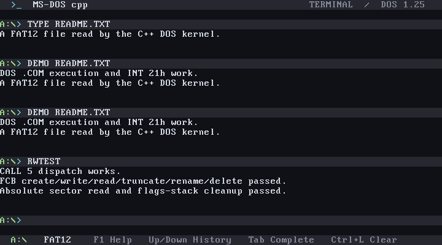
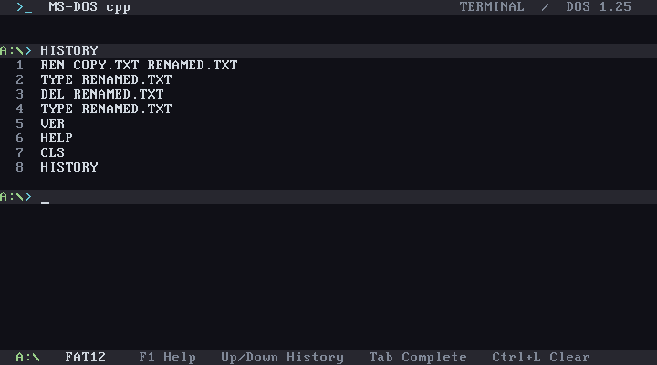

# MS-DOS-cpp

Work toward a bootable C++ rewrite of the Microsoft MS-DOS source release, covering **all versions, starting with 1.25**. This is an independent project based on the MIT-licensed Microsoft material.

**The end-to-end rewrite is not complete.** The current deliverable is a bootable DOS 1.25 compatibility kernel and a working source-conversion pipeline. The original kernel and COMMAND have not been fully translated. DOS 4.0 now has 30 complete mapper module bodies translated into C++; its kernel, BIOS, COMMAND, and most utilities remain reference inputs. [Conversion coverage](reports/coverage.md) and the [DOS 4.0 file audit](reports/v4-missing.md) track that explicitly.

## What works now

- A 1.44 MB FAT12 disk image builds with a freestanding C++ real-mode kernel, writable root files, native `.COM` loading, PSP/default FCB setup, and DOS 1.25 compatibility services. The kernel implements cluster allocation, persistence to both FAT copies, create/truncate, sequential/random/block reads and writes, rename, delete, and record-position handling.
- Complete original **HEX2BIN.ASM** and **TRANS.ASM** sources automatically generate executable C++ and run as host utilities. TRANS includes its opcode tables and indirect dispatch; it translates Z80 source into 8086 assembly, like the original.
- Original FAT packing, interrupt-vector setup, FCB record-position routines, and a DOS 2.0 date-table routine also generate C++. The converter derives MASM field offsets from source structure declarations and can lift connected routines from separate source sections.
- Original COMMAND routines SCANOFF, DELIM, INDIG, GETNUM, SHOW, OUT2 and OUT now generate C++, with exhaustive digit/delimiter and formatting tests. AAM/AAD semantics are implemented in the translation substrate.
- Thirty DOS 4.0 MAPPER modules generate buildable C++ with the original far-call ABI and expanded source macros. They cover file/directory operations, memory allocation, dates, verification, messages, device queries, character conversion, and video BIOS calls. Their DOS/BIOS services are explicit external dependencies; these host-library modules are not installed in the boot image. [Module status and usage](docs/dos-4.0-porting.md) explain the boundaries and preserved source quirks.
- The C++ shell supports DIR (wildcards, /W, /P), TYPE, binary COPY, REN/RENAME, DEL/ERASE, REM, PAUSE, DATE, TIME, VERIFY and batch files with %0–%9 arguments. AUTOEXEC.BAT runs if present. Its modern terminal uses a charcoal VGA palette, fixed header/status bars, a colored `A:\>` input row, command history, and Tab completion. [Terminal controls](docs/terminal.md) describe the keyboard shortcuts and new CLS/CLEAR, VER and HISTORY commands. Named FCB devices and a BIOS-tick clock are implemented with the limits listed in the [DOS 1.25 service status](docs/dos-1.25-services.md).
- All four reference trees, their supplied binaries, and the original license are under `reference/`; nothing depends on the sibling `MS-DOS` directory.
- The inventory covers 694 ASM files, 244 INC files, and 148 C/H files: 569,424 source lines. It records hashes, include references, procedure locations, and hardware boundaries.

The image has been **booted successfully in the installed VirtualBox 7.2.20**, as well as v86. Both passed the guest smoke checks: prompt, DIR, TYPE, two native DEMO launches, CALL 5, FCB create/write/read/truncate/rename/delete, INT 25h and shell COPY/REN/DEL. [VirtualBox results](reports/boot-runtime-virtualbox.json), [guest transcript](reports/boot-smoke-virtualbox.txt), and [boot screenshot](reports/virtualbox-boot.png) record the evidence and tested image hash. This establishes the tested behavior; broader DOS compatibility remains incomplete.

## VirtualBox screenshots

These screenshots show the actual guest display captured by `node tools/boot-smoke-vbox.mjs`.

**Booted DOS 1.25 compatibility shell**


**Native COM execution and filesystem checks**



**Command history after the shell smoke tests**



The [guest transcript](reports/boot-smoke-virtualbox.txt) and [runtime report](reports/boot-runtime-virtualbox.json) contain the complete results.

## Build and test

The host utilities require CMake, a C++20 compiler, and Node.js for conversion/tests. The boot image also requires NASM and GNU `g++`, `ld`, and `objcopy`. The boot target has been built with the installed Windows MinGW tools; its GCC `-m16` output requires a **386 or newer**, not an original 8086.

```powershell
node tools/convert.mjs generate
cmake -S . -B build -G Ninja -DCMAKE_BUILD_TYPE=Release
cmake --build build
ctest --test-dir build --output-on-failure
cmake --build build --target v4_audit
cmake --build build --target boot_image
```

Image: `build/boot/msdos-cpp.img` (1.44 MB raw FAT12 floppy). To test using the installed VirtualBox:

```powershell
node tools/boot-smoke-vbox.mjs
# Or: cmake --build build --target boot_smoke_virtualbox
```

The script creates a dedicated **MS-DOS-cpp** VM with 16 MB RAM, a BIOS boot and a floppy controller. It boots a disposable copy of the image, sends commands through the virtual keyboard, records COM1 output and screenshots, then powers off the test VM. The VM remains registered and its files are under `build/virtualbox/`. Run it from the same Windows account as VirtualBox Manager: VM registration is per account. The existing VM is registered in `zachn`'s Manager alongside the WRK VMs. A missing registration or active VM stops the test before altering the previous boot reports. Set `VBOXMANAGE` if the executable is outside the standard installation path. An unrelated VM with the same name is never modified. These settings use the [VirtualBox command reference](https://docs.oracle.com/en/virtualization/virtualbox/7.2/user/vboxmanage.html).

Open **MS-DOS-cpp** in VirtualBox Manager and click **Start**, or launch its window from PowerShell:

```powershell
& 'C:/Program Files/Oracle/VirtualBox/VBoxManage.exe' startvm MS-DOS-cpp --type gui
```

Alternatively, attach `build/boot/msdos-cpp.img` to the floppy controller of a new DOS VM and put **Floppy** first in the BIOS boot order. Use a copy when testing writes.

With QEMU installed:

```powershell
qemu-system-i386 -drive file=build/boot/msdos-cpp.img,format=raw,if=floppy -boot a -serial stdio
```

For the same smoke checks with QEMU, run `node tools/boot-smoke.mjs`. Set the `QEMU` environment variable if its executable is outside PATH. QEMU snapshot mode keeps the built image unchanged. QEMU is not installed here and this backend has not been run. Optional v86 setup and testing use `node tools/setup-v86.mjs` followed by `node tools/boot-smoke-v86.mjs`; downloaded assets stay under `build/emulator/` and are SHA-256 checked against `tools/v86-assets.json`. The v86 integration follows its [Node.js example](https://github.com/copy/v86/blob/master/examples/nodejs.js).

At the prompt, `HELP` lists commands. `DEMO README.TXT` is a standard DOS COM program that prints through `INT 21h`, opens/reads an FCB file, and terminates through `INT 20h`. `RWTEST` is a native DOS program that checks CALL 5, FCB create/write/read/truncate/rename/delete, absolute sector reads and the flags-stack convention. Both execute successfully in VirtualBox. Unmodified historical COMP, CHKDSK, and EDLIN binaries are included for future compatibility experiments; **their compatibility is unverified**.

There is a dispatch branch for every original DOS 1.25 function 0–46, but that does **not** establish full behavior compatibility. [The service matrix](docs/dos-1.25-services.md) records partial console editing, device behavior, process callbacks, media handling, clock and COMMAND semantics. Unsupported later DOS calls report their function number and terminate the program. EXE loading, nested EXEC, TSRs, full Ctrl-C/critical-error handling, COMMAND parity, and complete DOS ABI compatibility remain to implement. Guest BIOS interrupts are available to native programs, but broad compatibility is not established.

## Run the converted utilities

```powershell
build/hex2bin.exe input.hex output.com
build/hex2bin.exe input.hex output.com +0
build/trans.exe input.z80 output.asm
```

HEX2BIN defaults to subtracting `100H` from load addresses. The host CLI validates offset spelling and rejects using the same file for input/output. The translated original utility preserves its historical parsing behavior: checksums and record types are ignored, zero-length records end conversion, addresses wrap at 16 bits, punctuation `:` through `@` is accepted by HEXCHK, and parsing errors can still produce partial output. It is not a strict modern Intel HEX reader.

TRANS expects DOS text with CRLF line endings; control-Z ends input. It preserves the original 128-byte output record padding, translation diagnostics, and supported-opcode limitations. For example, the original table has no NOP entry. It is not a general modern Z80 compiler.

## Conversion approach

`tools/convert.mjs` parses the original source and emits compiled C++ statements, labels, conditional branches, and loops. All 38 generated units use this execution model: there is no `m.tick()` call or per-instruction program-counter loop. `Machine` supplies DOS register, memory, arithmetic, flag, string, stack, and interrupt state; it has no instruction executor. The boot kernel runs COM machine code directly on the guest CPU. [Native C++ execution](docs/native-cpp-execution.md) explains the remaining ABI adapter.

The converter recognizes the older Seattle Computer Products dialect separately from MASM. In that dialect, `JP` is an unconditional jump, `LODB` means LODSB, `DM` marks a string's last byte, and numeric token declarations use `ORG 1`. Unsupported instructions, directives, missing symbols, ambiguous sizes, and unresolved branches stop conversion. No successful stub bodies are emitted.

The generated units use relocated data addresses and DOS return/table tokens. Ordinary instructions execute as compiled statements, direct jumps become C++ branches, and REP becomes a C++ loop. Internal DOS calls retain stack tokens, with a bounded switch for their dynamic returns; TRANS also needs a bounded switch for its opcode table jump. These preserve its nonlocal stack resets. The units do not preserve original instruction addresses, instruction sizes, or binary layout; self-modifying code and arbitrary original code pointers require a different approach. The supported `$+5` pattern is restricted to skipping one direct JMP. The CALL-5 host bridge is limited to the TRANS backend and is not a general CP/M entry implementation.

DOS 4.0 module conversion expands the actual reviewed `MAPPER/MACROS.INC`, derives DB/DW/DD structure offsets, translates LDS/LES far pointers, and preserves callee parameter cleanup on far RET. Complete-module mode processes the whole file and rejects selected source sections, unreviewed includes, unresolved external symbols, and unsupported instructions. Generated files retain original source line numbers and source/include hashes.

The boot kernel's FAT12 packing/unpacking and FCB layout/position rules follow `v1.25/source/MSDOS.ASM`; the compatibility kernel implements DOS behavior manually in freestanding C++. It should not be counted as a full source translation of MSDOS.ASM. Hardware startup, BIOS calls, interrupt save/restore, CALL 5 and far COM entry remain in the assembly files under `boot/`.

To regenerate the inventory without writing generated C++:

```powershell
node tools/convert.mjs audit
# Audit every DOS 4.0 file and run the built mapper tests:
node tools/audit-v4.mjs --validate
```

Add reviewed translation units to `tools/units.json`, regenerate, add them to CMake, and validate observable behavior independently. Generated code contains original line references and whole-source SHA-256 hashes. A translation count alone is not proof of correctness.

## Optional Ghidra analysis

The source converter is the automatic conversion tool used here. For compiled DOS binaries, [Ghidra defines a 16-bit real-mode x86 language](https://github.com/NationalSecurityAgency/ghidra/blob/master/Ghidra/Processors/x86/data/languages/x86.ldefs). [RetDec's supported x86 targets](https://github.com/avast/retdec) list 32/64-bit x86, so it was not selected for this 16-bit code.

A headless Ghidra exporter is provided, based on the official [headless analyzer options](https://github.com/NationalSecurityAgency/ghidra/blob/master/Ghidra/RuntimeScripts/support/analyzeHeadlessREADME.md) and [decompiler API](https://ghidra.re/ghidra_docs/api/ghidra/app/decompiler/DecompInterface.html):

```powershell
tools/ghidra/Decompile-Dos.ps1 -GhidraHome C:/tools/ghidra -Binary reference/v1.25/bin/COMP.COM
```

Ghidra and its required JDK are not installed here, so this optional workflow has not been run. Its `.c` exports are analysis inputs, not automatically buildable C++ ports; they are kept outside the build.

## Validation

Eight CTest groups pass: CPU semantics, DOS 4.0 mapper contracts, native control flow, the actual kernel C++ with stubbed BIOS/COM entry, FAT12 image layout, reproducible source conversion, HEX2BIN integration, and TRANS integration. Tests exhaust all 8-bit add/subtract operands with carry/borrow, every input byte for HEXCHK, every 12-bit FAT value for neighboring-nibble preservation, and every FAT cluster for the lifted PACK comparison. DOS 4.0 tests check all 30 modules, far-stack cleanup and register preservation, all 65,536 allocation sizes, signed validation boundaries, output bounds, DOS/BIOS calls, errors, and historical quirks. Native-flow fixtures cover nested returns, indirect tables, invalid targets, termination, REP, and nonlocal stack resets. TRANS output matches byte-for-byte baselines from the previous backend across all 20 opcode handlers and error recovery. The audit tests reject changed/missing reference files and stale or unbuilt translations. Integration tests cover fragmented reads, filesystem writes surviving a volume reload, FAT-copy consistency, zero-filled gaps, truncation/reclamation, disk-full and I/O failures, corrupt chains, FCB search/records/devices, parser flags, clocks, absolute sectors, shell copies and batch execution, console calls, and PSP setup. The freestanding kernel builds with compiler warnings treated as errors; linker assertions reserve boot-image and interrupt-stack space.

Guest tests additionally verified actual boot, native COM interrupt/stack behavior and disk writes in VirtualBox and v86. They caught and fixed cylinder loss during CHS conversion and the missing kernel ES restoration at interrupt entry. These checks do not establish binary equivalence with original DOS or all-program compatibility. [The remaining work](PORTING.md) is tracked by subsystem and version.

## License

The Microsoft sources and derived translations retain the [MIT License](LICENSE). The reference sources are preserved byte-for-byte. This project is not affiliated with or endorsed by Microsoft.
