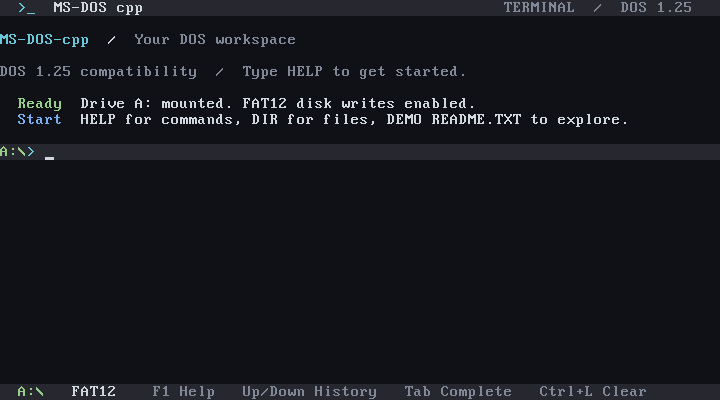

# Modern DOS terminal

The bootable shell has a dark terminal style inspired by Codex and PowerShell:
charcoal background, soft white text, cyan headings, blue executable names,
green prompts and copy confirmations, and red missing-file/command messages.
The header and keyboard status bar stay visible while command output scrolls.
The active `A:\>` row has a contrasting background.

Build `cmake --build build --target boot_image`, then boot
`build/boot/msdos-cpp.img`. The existing VirtualBox test VM uses a disposable
image copy refreshed by `node tools/boot-smoke-vbox.mjs`; shut it down before
refreshing the disk. Restart a running DOS guest to load the new kernel.

| Key | Action |
| --- | --- |
| Up / Down | Browse the last eight commands; Down restores the current draft. |
| Tab | Complete built-in commands and COM/BAT names, or a filename in an argument. Ambiguous matches extend to their shared prefix. |
| Left / Right | Move within the command. Typing inserts at the cursor. |
| Home / End | Move to the start/end of the command. |
| Backspace / Delete | Remove the previous/current character. |
| F1 | Run HELP. |
| Ctrl+L | Clear the screen and preserve the command being edited. |
| Esc / Ctrl+U / Ctrl+C | Clear the current input. |

`CLS` and `CLEAR` clear the output while preserving the header/status bar.
`VER` shows the compatibility version. `HISTORY` lists recent commands.
`HELP` lists DOS file commands and keyboard controls. `DIR` uses aligned
columns, muted timestamps, and a free-space summary; `/W`, `/P`, and wildcards
remain supported.

The terminal is native 80×25 VGA text mode with the BIOS monospace font. It
keeps DOS 8.3 filenames, drive A's root directory, and COM/BAT execution; it
does not implement PowerShell commands. Command input is limited to 127 ASCII
characters. History lasts for the current boot session, and repeated adjacent
commands occupy one entry. Advanced editing keys use BIOS keyboard scan codes;
the COM1 test console accepts plain text, Tab, Backspace, and control characters.

Applications using DOS console services render in the scrolling terminal.
Programs that directly change the video mode, VGA memory, or BIOS display may
replace the shell display; those programs have no added compatibility guarantee.
Serial output remains plain text without ANSI styling.
